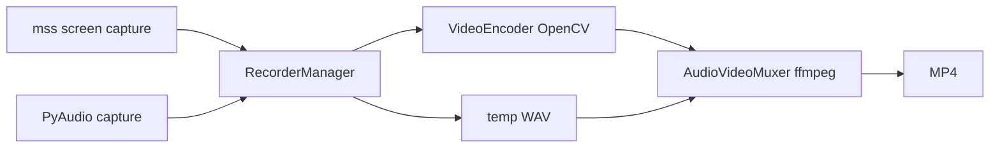

# ScreenR

Desktop screen recorder for Windows and Linux built with PySide6. Records the full screen or a selected area, optionally with audio, and saves an MP4.

<!-- TODO: screenshot of the main window (light and dark theme) -->

 

## Features

- Full-screen or selected-area capture (`mss` frame grabbing, interactive area selector overlay).
- Audio source choice in the UI: system audio, microphone, or none (PyAudio capture, written to a temporary WAV).
- Quality presets (low, medium, high), 30 FPS target.
- Start delay timer (3, 5 or 10 seconds, or none), pause and resume.
- Light and dark Qt themes.
- Video is encoded with OpenCV (`mp4v`, with XVID/MJPG AVI fallbacks); audio and video are merged with FFmpeg when it is installed.
- Output goes to `~/Videos/ScreenR` as `screen_recording_<timestamp>.mp4`.

## How it works



`recorder/recorder_manager.py` coordinates capture threads, the encoder and the muxer. The Qt window (`main.py`) drives it.

## Getting started

Prerequisites: Python 3.11+, [uv](https://docs.astral.sh/uv/), FFmpeg on `PATH` (needed only to merge audio into the video), and PortAudio for PyAudio (Linux: `portaudio19-dev`).

```bash
uv sync
uv run python main.py
```

### Prebuilt binaries

Two GitHub Actions workflows build single-file executables with PyInstaller on push to `main` or manual dispatch:

- `.github/workflows/build-linux.yml` produces the `ScreenRecorder-Linux` artifact.
- `.github/workflows/build-windows.yml` produces the `ScreenRecorder-Windows` artifact (`main.exe`).

They are uploaded as workflow run artifacts, not published as GitHub Releases. To build locally:

```bash
uv pip install pyinstaller
uv run pyinstaller --onefile --windowed --clean main.py
```

## Tech stack

Python, PySide6 (Qt), mss, OpenCV, NumPy, PyAudio, FFmpeg, PyInstaller, uv.

## Project structure

```
main.py                   Qt main window and wiring
recorder/                 capture, audio, encoder, muxer, area selector, manager
ui/                       Qt Designer files; ui_screen_recorder.py is generated from screen_recorder_v1.ui
resources/                icons, QSS themes, compiled resources_rc.py
tests/                    manual scripts (capture, audio, area selector), not an automated suite
.github/workflows/        Linux and Windows build workflows
```

To regenerate generated files after editing the UI: `pyside6-uic ui/screen_recorder_v1.ui -o ui/ui_screen_recorder.py` and `pyside6-rcc resources/resources.qrc -o resources/resources_rc.py`.

## Status and limitations

- Working prototype; no automated tests. `tests/` contains hands-on scripts that need a display and audio devices.
- System-audio capture depends on the available PyAudio input devices (for example a loopback or monitor device); it has not been verified on every platform.
- `ui/screen_recorder_v2.ui` is an unused design draft; the app uses v1.
- Built binaries have not been tested beyond the CI build.

## License

MIT, see [LICENSE](LICENSE).
